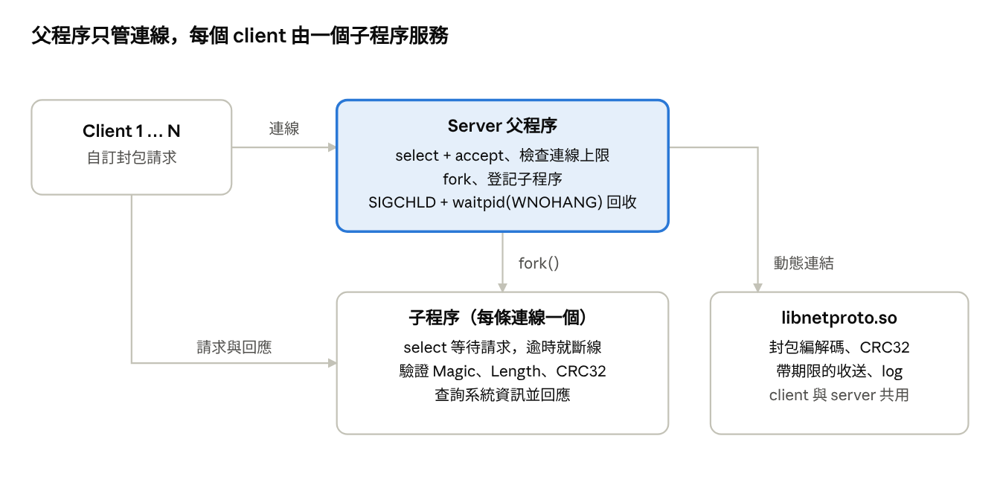
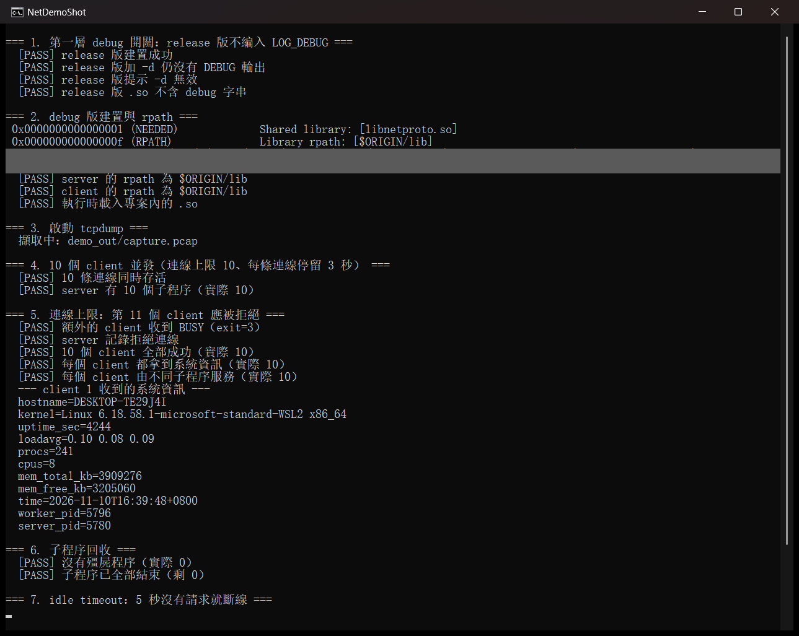
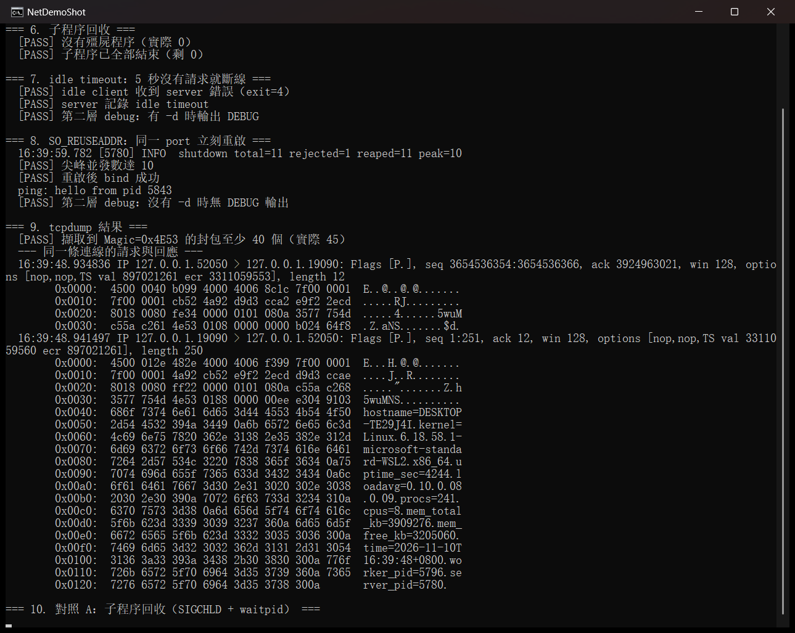
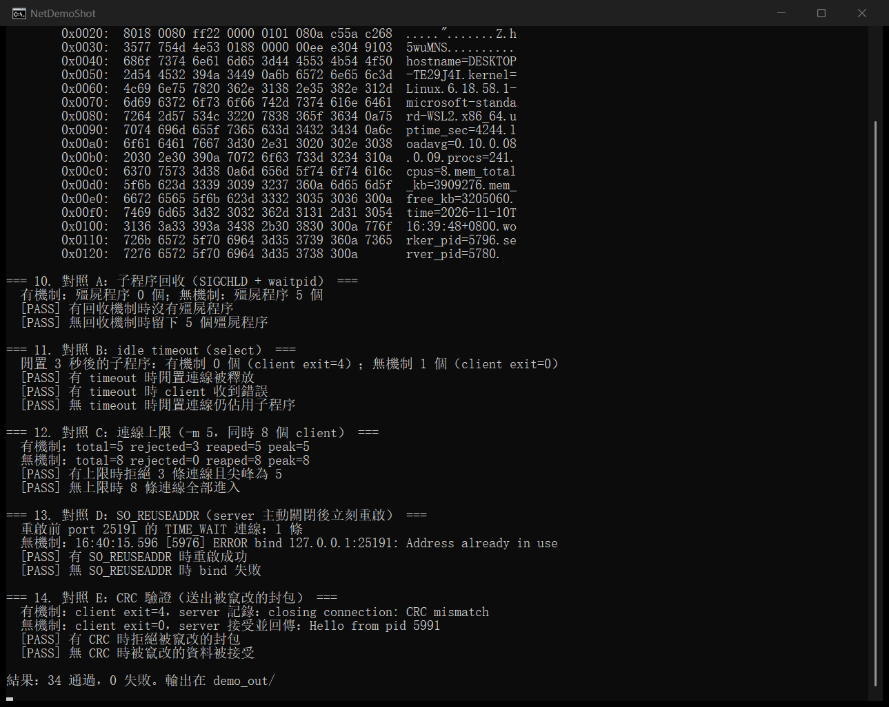

# 網路與系統程式設計 期中報告：Fork 多程序系統資訊 Client–Server

2026-11-10

## 1. 摘要與需求對照

本專案以 C 實作 Linux client–server 系統資訊服務，期中規格的 8 項程式要求都有實作與執行證明。`demo.sh` 一行完成編譯、10 個 client 並發、tcpdump 與對照實驗；最終版連續 4 次執行，每次 34 項檢查全部通過。

| 規格要求 | 本專案做法 | 執行證明 |
| --- | --- | --- |
| 每條連線 fork() 一個子程序，不用 thread | `accept()` 後 `fork()`，子程序處理該連線後結束 | 10 個 client 由 10 個不同 `worker_pid` 服務 |
| 至少同時處理 10 個 client | 預設上限 32，可設 1–512 | log 出現 `active=10/10`，shutdown 記錄 `peak=10` |
| 封包擷取與分析 | tcpdump 擷取 loopback | 第 7 節逐欄位解析 |
| 兩層 debug log | `#ifdef DEBUG`（編譯時）與 `-d`（執行時） | 三種組合的輸出差異，見第 6 節 |
| 共用函式包成 .so，兩端連結 | `lib/libnetproto.so`，以 rpath `$ORIGIN/lib` 連結 | `readelf` 顯示 `RPATH [$ORIGIN/lib]` |
| client 查詢系統資訊 | 主機名、核心、uptime、負載、記憶體、時間 | 第 6 節的查詢輸出 |
| 異常處理與至少三組有無機制對照 | 5 組對照，加上畸形封包測試 | 第 8 節 |
| Makefile 建置 | `make`、`make debug`、`make demo` | `demo.sh` 第 1、2 階段 |

## 2. 系統設計說明

Server 採用「父程序只管連線、子程序只服務一個 client」的分工，因此一個 client 卡住或崩潰不會影響其他連線。父程序負責 `select` + `accept`、檢查名額、`fork` 與回收子程序；子程序關閉 listen socket，反覆收請求、回應，直到 BYE、錯誤或 idle timeout。



模組切分：

| 檔案 | 職責 |
| --- | --- |
| `include/netproto.h` | 協定常數、OpCode、錯誤碼、log 巨集與函式庫介面 |
| `src/proto.c` | CRC32、封包編解碼、帶期限的 socket 收送、整數解析 |
| `src/log.c` | 帶時間與 PID 的 log，整行一次 `write` 避免多程序輸出交錯 |
| `src/server.c` | 程序管理、訊號處理、連線上限、系統資訊查詢 |
| `src/client.c` | 命令列查詢工具，以結束碼回報結果 |
| `Makefile`、`demo.sh` | 建置與自動化測試 |

常見流程是：client 連線、送查詢、收回應、送 BYE，等 server 先關閉後結束。Client 等 server 先關閉，是為了讓 TIME\_WAIT 固定留在 server 端，這正是 SO\_REUSEADDR 要解決的情境。

## 3. 自訂封包協定

每個封包是 12 bytes header 加上最多 8192 bytes 的 payload，多位元組欄位一律使用 network byte order。程式逐欄位用 `memcpy` 序列化，不依賴 struct 的記憶體配置。

| Offset | 大小 (bytes) | 欄位 | 說明 |
| --- | --- | --- | --- |
| 0 | 2 | Magic | 固定 `0x4E53`（ASCII "NS"） |
| 2 | 1 | Version | 目前為 1 |
| 3 | 1 | OpCode | 請求或回應類型 |
| 4 | 4 | Length | payload 長度，不含 header |
| 8 | 4 | CRC32 | IEEE 802.3，涵蓋 header 前 8 bytes 與 payload |
| 12 | N | Payload | key=value 文字、ping 資料或錯誤訊息 |

CRC32 涵蓋 header 前 8 bytes，所以 OpCode 或 Length 被竄改也能偵測。回應的 OpCode 是請求的 OpCode 加上 `0x80`。

| OpCode | 名稱 | 用途 |
| --- | --- | --- |
| `0x01` | PING | payload 原樣回傳 |
| `0x02` | HOSTNAME | 主機名 |
| `0x03` | UPTIME | 開機秒數 |
| `0x04` | LOADAVG | 負載、程序數、CPU 數 |
| `0x05` | MEMINFO | 總記憶體與空閒記憶體 |
| `0x06` | KERNEL | 核心名稱、版本、架構 |
| `0x07` | TIME | server 當地時間 |
| `0x08` | ALL | 全部資訊加子程序 PID |
| `0x0F` | BYE | 結束連線 |
| `0xFE` | BUSY | 達連線上限，server 隨後關閉 |
| `0xFF` | ERROR | payload 為錯誤訊息 |

接收時先驗證 Magic、Version、Length，通過才依 Length 收 payload，避免依不可信的長度繼續讀取。協定錯誤發生後串流已無法對齊封包邊界，所以 server 回傳 ERROR 後關閉連線；未知 OpCode 的封包框架仍完整，回 ERROR 後連線繼續。

## 4. 關鍵程式碼說明

以下六個機制決定 server 的並發與穩定性，完整程式見第 10 節。

### 4.1 子程序回收：sigaction 加 waitpid 迴圈

多個子程序同時結束時，SIGCHLD 可能只送達一次，所以 handler 必須用迴圈回收到沒有為止。Handler 內保存並還原 `errno`，也不呼叫 log，因為 log 不是 async-signal-safe。

```c
static void on_sigchld(int sig)
{
    int saved_errno = errno;
    pid_t pid;

    (void)sig;
    while ((pid = waitpid(-1, NULL, WNOHANG)) > 0) {
        for (int i = 0; i < g_max_conn; i++) {
            if (g_children[i] == pid) {
                g_children[i] = 0;
                g_active--;
                g_reaped++;
                break;
            }
        }
    }
    errno = saved_errno;
}
```

### 4.2 fork 與連線上限

名額檢查、`fork` 與登記子程序期間會擋住 SIGCHLD、SIGINT、SIGTERM，避免 handler 在計數更新途中插入。超過上限時，server 仍 `accept` 連線，回傳 BUSY 封包再關閉，client 才能分辨「忙碌」與「連不上」。

```c
sigprocmask(SIG_BLOCK, &block_mask, &orig_mask);

if (g_active >= g_max_conn) {
    /* 回傳 OP_BUSY 後關閉連線 */
}

pid = fork();
if (pid == 0)
    run_child(listen_fd, conn_fd, idle_sec, &orig_mask);
```

子程序在 `run_child` 先把訊號處理還原為預設值，再解除遮罩，然後關閉 listen socket。

### 4.3 select() 做 idle timeout

`proto_recv` 對整個封包只算一個期限，每次 `select` 都用剩餘時間，被訊號打斷也不會重新計時。因此一次送 1 byte 的慢速連線，也會在期限內被切斷。

```c
int64_t left = deadline_ms - now_ms();

if (left <= 0)
    return PROTO_ERR_TIMEOUT;
tv.tv_sec = left / 1000;
tv.tv_usec = (left % 1000) * 1000;
```

傳送方向另外設定 `SO_SNDTIMEO`，避免對方一直不讀取時，`send` 永遠佔住名額。

### 4.4 SO\_REUSEADDR

必須在 `bind` 之前設定。Server 主動關閉的連線會在該 port 留下 TIME\_WAIT，沒有這個選項時，重啟會得到 `Address already in use`。

```c
if (!g_no_reuseaddr &&
    setsockopt(fd, SOL_SOCKET, SO_REUSEADDR, &on, sizeof(on)) < 0) {
```

### 4.5 兩層 debug log

編譯時由 `#ifdef DEBUG` 決定 `LOG_DEBUG` 是否編入，執行時由 `-d` 決定是否輸出。Release 版的巨集保留 `if (0)`，編譯器仍檢查格式，最佳化後不留下字串。

```c
#ifdef DEBUG
#define LOG_DEBUG(fmt, ...)                                            \
    do {                                                               \
        if (log_debug_enabled())                                       \
            log_msg("DEBUG", "%s:%d: " fmt, __FILE__, __LINE__,        \
                    ##__VA_ARGS__);                                    \
    } while (0)
#else
#define LOG_DEBUG(fmt, ...)                                            \
    do {                                                               \
        if (0)                                                         \
            log_msg("DEBUG", fmt, ##__VA_ARGS__);                      \
    } while (0)
#endif
```

### 4.6 共用函式庫與 rpath

Client 與 server 共用 `lib/libnetproto.so`。`$ORIGIN/lib` 讓執行檔依自身位置尋找函式庫，專案搬到別的路徑也能執行，不需要設定 `LD_LIBRARY_PATH`。Makefile 中 `$$` 是 make 的跳脫寫法，`--disable-new-dtags` 讓連結器寫入 `DT_RPATH`。

```make
RPATH    := -Wl,-rpath,'$$ORIGIN/lib' -Wl,--disable-new-dtags

$(BINS): %: obj/%.o $(LIB)
	$(CC) $(LDFLAGS) -o $@ $< -Llib -lnetproto $(RPATH)
```

## 5. 建置與執行方式

在 Ubuntu 或 WSL 安裝 `build-essential` 與 `tcpdump` 後，一行指令就能重現本報告的所有結果：

```bash
./demo.sh
```

非 root 使用者執行時，tcpdump 那一步會以 sudo 詢問一次密碼。

| 指令 | 作用 |
| --- | --- |
| `make` | 建置 release 版，不編入 `LOG_DEBUG` |
| `make debug` | 建置 debug 版，加上 `-DDEBUG` |
| `make clean` | 刪除建置產物與 `demo_out` |
| `make demo` | 執行 `demo.sh` |

| Server 選項 | 說明 | 預設 |
| --- | --- | --- |
| `-b addr` | 綁定位址，跨機器連線用 `0.0.0.0` | `127.0.0.1` |
| `-p port` | 監聽 port | 9000 |
| `-m max_conn` | 連線上限，1–512 | 32 |
| `-t idle_sec` | idle timeout（秒） | 30 |
| `-d` | 開啟 debug log，需 debug 版 | 關閉 |
| `-X name` | 對照實驗用，關閉 `reap`、`idle`、`limit`、`reuseaddr` 或 `crc` | 全部啟用 |

| Client 選項 | 說明 | 預設 |
| --- | --- | --- |
| `-s host` | server 位址 | `127.0.0.1` |
| `-p port` | server port | 9000 |
| `-q query` | `ping`、`hostname`、`uptime`、`load`、`mem`、`kernel`、`time`、`all` | `all` |
| `-w sec` | 查詢後保持連線的秒數 | 0 |
| `-t sec` | 等待回應的期限（秒） | 10 |
| `-B` | 送出被竄改的 ping，用來測試 CRC | 關閉 |
| `-d` | 開啟 debug log，需 debug 版 | 關閉 |

Client 結束碼：0 成功、1 連線或協定錯誤、2 參數錯誤、3 server 已達上限、4 server 回報錯誤。

## 6. 執行結果

最終版執行結果為 34 項檢查全部通過，10 個 client 同時連線的尖峰並發數達到 10。測試環境為 Windows 11 上的 WSL2 Ubuntu 26.04，gcc 15.2.0，tcpdump 4.99.6。

### 6.1 10 個 client 並發

Demo 啟動 server（上限 10），讓 10 個 client 各保持連線 3 秒，所以所有連線一定重疊。第 11 個 client 在滿載時連線，收到 BUSY 並以結束碼 3 離開。

```text
=== 4. 10 個 client 並發（連線上限 10、每條連線停留 3 秒） ===
  [PASS] 10 條連線同時存活
  [PASS] server 有 10 個子程序（實際 10）

=== 5. 連線上限：第 11 個 client 應被拒絕 ===
  [PASS] 額外的 client 收到 BUSY（exit=3）
  [PASS] server 記錄拒絕連線
  [PASS] 10 個 client 全部成功（實際 10）
  [PASS] 每個 client 都拿到系統資訊（實際 10）
  [PASS] 每個 client 由不同子程序服務（實際 10）
```

Server log 留下同時連線的證據：

```text
16:23:27.867 [5010] INFO  accepted 127.0.0.1:39558 worker=5036 active=10/10
16:23:27.892 [5010] WARN  rejected 127.0.0.1:39562: limit reached active=10/10
16:23:38.686 [5010] INFO  shutdown total=11 rejected=1 reaped=11 peak=10
```

### 6.2 系統資訊查詢

```text
hostname=DESKTOP-TE29J4I
kernel=Linux 6.18.58.1-microsoft-standard-WSL2 x86_64
uptime_sec=3263
loadavg=0.54 0.42 0.20
procs=230
cpus=8
mem_total_kb=3909276
mem_free_kb=2447160
time=2026-11-10T16:23:27+0800
worker_pid=5026
server_pid=5010
```

### 6.3 兩層 debug log

| 建置版本 | 執行參數 | DEBUG 輸出 | 實測結果 |
| --- | --- | --- | --- |
| release（無 `-DDEBUG`） | `-d` | 無 | 提示 `-d ignored`，`.so` 不含 debug 字串 |
| debug（`-DDEBUG`） | 無 `-d` | 無 | log 中 DEBUG 行數為 0 |
| debug（`-DDEBUG`） | `-d` | 有 | 每次收送都有記錄 |

```text
16:23:27.770 [5026] DEBUG src/proto.c:192: rx op=0x08 len=0 crc=b02464f8
16:23:27.777 [5026] DEBUG src/server.c:234: request op=0x08 len=0
16:23:27.780 [5026] DEBUG src/proto.c:124: tx op=0x88 len=238 crc=662e4a1b
```

### 6.4 執行截圖

以下是在 Windows 11 的終端機視窗執行 `./demo.sh` 的實際畫面，這次執行結果為 34 項通過、0 項失敗。



圖 1：建置、rpath、10 個 client 並發，第 11 個 client 收到 BUSY，子程序全部回收。灰色區塊是遮蔽的本機路徑。



圖 2：idle timeout、同一 port 重啟，以及 tcpdump 抓到的同一條連線請求與回應。



圖 3：zombie 回收、timeout、連線上限、SO\_REUSEADDR、CRC 五組對照，最後一行為 34 通過、0 失敗。

## 7. 封包擷取與分析

Tcpdump 在 loopback 抓到的封包與自訂格式完全一致，最終版共有 45 個封包的 TCP payload 以 Magic `0x4E53` 開頭。請求與回應都在同一個 TCP segment 內送出，因此可以直接用 BPF 過濾：

```bash
tcpdump -nn -r demo_out/capture.pcap -X -c 2 'tcp[((tcp[12] & 0xf0) >> 2):2] = 0x4e53'
```

下面是同一條連線的一組請求與回應，OpCode 為 ALL：

```text
16:23:27.769901 IP 127.0.0.1.39482 > 127.0.0.1.19090: Flags [P.], ... length 12
  0x0030:  5cda 07a7 4e53 0108 0000 0000 b024 64f8  \...NS.......$d.

16:23:27.783666 IP 127.0.0.1.19090 > 127.0.0.1.39482: Flags [P.], ... length 250
  0x0030:  c727 d2ef 4e53 0188 0000 00ee 662e 4a1b  .'..NS......f.J.
  0x0040:  686f 7374 6e61 6d65 3d44 4553 4b54 4f50  hostname=DESKTOP
```

| 欄位 | 請求 | 回應 | 解讀 |
| --- | --- | --- | --- |
| Magic | `4e53` | `4e53` | 協定識別碼 "NS" |
| Version | `01` | `01` | 版本 1 |
| OpCode | `08` | `88` | ALL，回應為 `0x08 \| 0x80` |
| Length | `00000000` | `000000ee` | 請求無 payload，回應 238 bytes |
| CRC32 | `b02464f8` | `662e4a1b` | 與 debug log 的 `crc=` 一致 |

TCP 長度也能對上：請求是 12 bytes 的 header，回應是 12 + 238 = 250 bytes。Payload 以明文傳送，所以 tcpdump 可以直接讀出 `hostname=` 等內容。

## 8. 穩健性機制對照

五組對照都使用同一份執行檔，只用 `-X` 關掉一個機制，所以行為差異直接來自該機制。前三組是規格要求的對照，後兩組是額外加入。

| 機制 | 關閉方式 | 實驗 | 有機制 | 無機制 |
| --- | --- | --- | --- | --- |
| zombie 回收 | `-X reap` | 5 個 client 執行完畢後檢查子程序 | 殭屍程序 0 個 | 殭屍程序 5 個 |
| idle timeout | `-X idle` | 期限 2 秒，client 閒置 4 秒，第 3 秒檢查 | 子程序 0 個，client 結束碼 4 | 子程序 1 個，client 結束碼 0 |
| SO\_REUSEADDR | `-X reuseaddr` | server 主動關閉後立刻重啟，port 有 1 條 TIME\_WAIT | 重啟成功 | `bind: Address already in use` |
| 連線上限 | `-X limit` | `-m 5`，同時 8 個 client | 拒絕 3 條，尖峰 5 | 拒絕 0 條，尖峰 8 |
| CRC 驗證 | `-X crc` | 送出 payload 被竄改的 ping | 拒絕，記錄 `CRC mismatch` | 接受並回傳 `Hello from pid ...` |

實測輸出：

```text
=== 10. 對照 A：子程序回收（SIGCHLD + waitpid） ===
  有機制：殭屍程序 0 個；無機制：殭屍程序 5 個

=== 11. 對照 B：idle timeout（select） ===
  閒置 3 秒後的子程序：有機制 0 個（client exit=4）；無機制 1 個（client exit=0）

=== 13. 對照 D：SO_REUSEADDR（server 主動關閉後立刻重啟） ===
  重啟前 port 29050 的 TIME_WAIT 連線：1 條
  無機制：16:23:54.235 [5201] ERROR bind 127.0.0.1:29050: Address already in use
```

影響分析：

- **沒有 zombie 回收：** 結束的子程序持續佔用程序表，連線計數也不會下降，最終連新連線都進不來。
- **沒有 timeout：** 不送資料的 client 會無限期佔住一個子程序與一個連線名額。
- **沒有 SO\_REUSEADDR：** server 重啟必須等 TIME\_WAIT 結束，故障恢復會被延遲。

另外以 Python 直接送原始位元組，驗證協定解析的異常處理（server 期限設為 2 秒）：

| 輸入 | Server 行為 |
| --- | --- |
| 錯誤 Magic | 回 `bad magic` 後關閉 |
| 錯誤 Version | 回 `unsupported version` 後關閉 |
| Length 為 4 GB 或 8193 | 回 `bad length` 後關閉，不繼續收資料 |
| 錯誤 CRC | 回 `CRC mismatch` 後關閉 |
| 未知 OpCode | 回 `unknown opcode`，連線繼續 |
| 最大 payload 8192 bytes | 正常回傳，CRC 正確 |
| 只送一半的 header 或 payload | 2.0 秒後回 `idle timeout` |
| 送到一半就斷線 | 記錄 `truncated packet`，子程序結束 |
| 每 0.7 秒送 1 byte | 約 2 秒後斷線，此 client 在 2.8 秒收到斷線錯誤 |
| 大量送請求但不讀回應 | 子程序送出失敗後結束，不殘留 |

## 9. 測試限制與討論

目前的驗證都在單機 loopback 完成，以下是尚未涵蓋或設計上的限制。

- **執行權限：** 上述結果是以 root 執行 `demo.sh` 取得；一般使用者透過 sudo 啟動 tcpdump 的流程尚未實測。
- **網路環境：** 未測試跨電腦連線，server 預設只綁 `127.0.0.1`。
- **安全性：** CRC32 只偵測傳輸錯誤，攻擊者可以重算 CRC，協定也沒有加密與身分驗證。對外開放前需要另外加上。
- **負載上限：** 每條連線 fork 一次，成本隨連線數增加；程式上限為 512 條，實測最多到 10 條並發。
- **對照選項：** `-X` 只供實驗，正式執行不應使用。關閉上限時實際上限是追蹤表容量 512，避免陣列滿滿。

## 10. 完整原始碼

專案共 7 個檔案，總計約 1,460 行。

### include/netproto.h

```c
/*
 * netproto.h - libnetproto.so 的公開介面：封包協定與 log。
 *
 * 封包格式（多位元組欄位皆為 network byte order）：
 *
 *   offset  size  field
 *        0     2  Magic   (0x4E53, "NS")
 *        2     1  Version (1)
 *        3     1  OpCode
 *        4     4  Length  (payload 長度，不含 header)
 *        8     4  CRC32   (涵蓋 header 前 8 bytes + payload)
 *       12     N  Payload
 */
#ifndef NETPROTO_H
#define NETPROTO_H

#include <stddef.h>
#include <stdint.h>

#define PROTO_MAGIC        0x4E53
#define PROTO_VERSION      1
#define PROTO_HEADER_SIZE  12
#define PROTO_MAX_PAYLOAD  8192

/* 回應的 OpCode = 請求的 OpCode | PROTO_OP_RESPONSE */
#define PROTO_OP_RESPONSE  0x80

enum proto_opcode {
    OP_PING     = 0x01, /* payload 原樣回傳 */
    OP_HOSTNAME = 0x02,
    OP_UPTIME   = 0x03,
    OP_LOADAVG  = 0x04,
    OP_MEMINFO  = 0x05,
    OP_KERNEL   = 0x06,
    OP_TIME     = 0x07,
    OP_ALL      = 0x08,
    OP_BYE      = 0x0F,
    OP_BUSY     = 0xFE, /* 已達連線上限，server 隨後關閉連線 */
    OP_ERROR    = 0xFF  /* payload 為錯誤訊息 */
};

enum proto_status {
    PROTO_OK            =  0,
    PROTO_ERR_CLOSED    = -1, /* 對方在封包邊界正常關閉 */
    PROTO_ERR_IO        = -2,
    PROTO_ERR_TIMEOUT   = -3,
    PROTO_ERR_MAGIC     = -4,
    PROTO_ERR_VERSION   = -5,
    PROTO_ERR_LENGTH    = -6,
    PROTO_ERR_CRC       = -7,
    PROTO_ERR_TRUNCATED = -8  /* 對方在封包中途關閉 */
};

typedef struct {
    uint8_t  opcode;
    uint32_t length;
    /* 多留 1 byte，收到後補 '\0' 方便當字串用 */
    uint8_t  payload[PROTO_MAX_PAYLOAD + 1];
} proto_packet_t;

/* CRC-32 (IEEE 802.3)，seed 傳 0；可把前一次結果當 seed 接續計算 */
uint32_t proto_crc32(uint32_t seed, const void *data, size_t len);

/* 將 header 與 payload 組成一筆送出，回傳 enum proto_status */
int proto_send(int fd, uint8_t opcode, const void *payload, uint32_t length);

/* 測試用：算完 CRC 後才竄改 payload 第一個 byte，模擬傳輸錯誤 */
int proto_send_corrupted(int fd, uint8_t opcode, const void *payload,
                         uint32_t length);

/* 對照實驗用：傳 0 時 proto_recv 不驗證 CRC */
void proto_set_crc_check(int enabled);

/*
 * 用 select() 等待並收一個完整封包。
 * timeout_sec 是整個封包的期限，傳 0 表示不限時。
 */
int proto_recv(int fd, proto_packet_t *pkt, int timeout_sec);

const char *proto_strerror(int status);

/* 解析十進位整數並檢查範圍，成功回傳 0，失敗回傳 -1 */
int parse_int(const char *text, int min, int max, int *out);

/* log：第一層 DEBUG 巨集決定是否編入，第二層 -d 決定執行時是否輸出 */
void log_set_debug(int enabled);
int  log_debug_enabled(void);
void log_msg(const char *level, const char *fmt, ...)
    __attribute__((format(printf, 2, 3)));

#define LOG_INFO(fmt, ...)  log_msg("INFO",  fmt, ##__VA_ARGS__)
#define LOG_WARN(fmt, ...)  log_msg("WARN",  fmt, ##__VA_ARGS__)
#define LOG_ERROR(fmt, ...) log_msg("ERROR", fmt, ##__VA_ARGS__)

#ifdef DEBUG
#define LOG_DEBUG(fmt, ...)                                            \
    do {                                                               \
        if (log_debug_enabled())                                       \
            log_msg("DEBUG", "%s:%d: " fmt, __FILE__, __LINE__,        \
                    ##__VA_ARGS__);                                    \
    } while (0)
#else
/* 保留 if (0) 讓編譯器仍檢查格式與參數，最佳化後不留下任何程式碼或字串 */
#define LOG_DEBUG(fmt, ...)                                            \
    do {                                                               \
        if (0)                                                         \
            log_msg("DEBUG", fmt, ##__VA_ARGS__);                      \
    } while (0)
#endif

#endif /* NETPROTO_H */
```

### src/proto.c

```c
/* proto.c - 封包編解碼、CRC32 與帶期限的 socket I/O */
#include "netproto.h"

#include <arpa/inet.h>
#include <errno.h>
#include <limits.h>
#include <stdlib.h>
#include <string.h>
#include <sys/select.h>
#include <sys/socket.h>
#include <time.h>

static int g_crc_check = 1;

void proto_set_crc_check(int enabled)
{
    g_crc_check = enabled;
}

uint32_t proto_crc32(uint32_t seed, const void *data, size_t len)
{
    const uint8_t *p = data;
    uint32_t crc = ~seed;

    while (len--) {
        crc ^= *p++;
        for (int bit = 0; bit < 8; bit++)
            crc = (crc >> 1) ^ (0xEDB88320U & (0U - (crc & 1U)));
    }
    return ~crc;
}

static int64_t now_ms(void)
{
    struct timespec ts;

    clock_gettime(CLOCK_MONOTONIC, &ts);
    return (int64_t)ts.tv_sec * 1000 + ts.tv_nsec / 1000000;
}

/* deadline_ms 為 0 表示不限時；被 signal 打斷時用剩餘時間重新等待 */
static int wait_readable(int fd, int64_t deadline_ms)
{
    if (fd >= FD_SETSIZE)
        return PROTO_ERR_IO;

    for (;;) {
        fd_set rfds;
        struct timeval tv, *tvp = NULL;

        if (deadline_ms > 0) {
            int64_t left = deadline_ms - now_ms();

            if (left <= 0)
                return PROTO_ERR_TIMEOUT;
            tv.tv_sec = left / 1000;
            tv.tv_usec = (left % 1000) * 1000;
            tvp = &tv;
        }

        FD_ZERO(&rfds);
        FD_SET(fd, &rfds);

        int n = select(fd + 1, &rfds, NULL, NULL, tvp);
        if (n > 0)
            return PROTO_OK;
        if (n == 0)
            return PROTO_ERR_TIMEOUT;
        if (errno != EINTR)
            return PROTO_ERR_IO;
    }
}

static int recv_full(int fd, void *buf, size_t len, int64_t deadline_ms)
{
    uint8_t *p = buf;
    size_t got = 0;

    while (got < len) {
        int rc = wait_readable(fd, deadline_ms);
        if (rc != PROTO_OK)
            return rc;

        ssize_t n = recv(fd, p + got, len - got, 0);
        if (n == 0)
            return got == 0 ? PROTO_ERR_CLOSED : PROTO_ERR_TRUNCATED;
        if (n < 0) {
            if (errno == EINTR || errno == EAGAIN || errno == EWOULDBLOCK)
                continue;
            return PROTO_ERR_IO;
        }
        got += (size_t)n;
    }
    return PROTO_OK;
}

static int send_frame(int fd, uint8_t opcode, const void *payload,
                      uint32_t length, int corrupt)
{
    uint8_t frame[PROTO_HEADER_SIZE + PROTO_MAX_PAYLOAD];
    uint16_t magic = htons(PROTO_MAGIC);
    uint32_t net_len = htonl(length);
    uint32_t crc, net_crc;

    if (length > PROTO_MAX_PAYLOAD)
        return PROTO_ERR_LENGTH;

    /* 逐欄位寫入，不依賴 struct 的記憶體配置 */
    memcpy(frame, &magic, 2);
    frame[2] = PROTO_VERSION;
    frame[3] = opcode;
    memcpy(frame + 4, &net_len, 4);
    if (length > 0)
        memcpy(frame + PROTO_HEADER_SIZE, payload, length);

    crc = proto_crc32(0, frame, 8);
    crc = proto_crc32(crc, frame + PROTO_HEADER_SIZE, length);
    net_crc = htonl(crc);
    memcpy(frame + 8, &net_crc, 4);

    if (corrupt && length > 0)
        frame[PROTO_HEADER_SIZE] ^= 0x20;

    LOG_DEBUG("tx op=0x%02x len=%u crc=%08x", opcode, length, crc);

    size_t total = PROTO_HEADER_SIZE + (size_t)length;
    size_t sent = 0;

    while (sent < total) {
        /* MSG_NOSIGNAL：對方已關閉時回傳錯誤而不是收到 SIGPIPE */
        ssize_t n = send(fd, frame + sent, total - sent, MSG_NOSIGNAL);
        if (n < 0) {
            if (errno == EINTR)
                continue;
            return PROTO_ERR_IO;
        }
        sent += (size_t)n;
    }
    return PROTO_OK;
}

int proto_send(int fd, uint8_t opcode, const void *payload, uint32_t length)
{
    return send_frame(fd, opcode, payload, length, 0);
}

int proto_send_corrupted(int fd, uint8_t opcode, const void *payload,
                         uint32_t length)
{
    return send_frame(fd, opcode, payload, length, 1);
}

int proto_recv(int fd, proto_packet_t *pkt, int timeout_sec)
{
    uint8_t hdr[PROTO_HEADER_SIZE];
    uint16_t magic;
    uint32_t net_len, net_crc, want, crc;
    int64_t deadline = timeout_sec > 0 ? now_ms() + timeout_sec * 1000LL : 0;
    int rc;

    rc = recv_full(fd, hdr, sizeof(hdr), deadline);
    if (rc != PROTO_OK)
        return rc;

    memcpy(&magic, hdr, 2);
    memcpy(&net_len, hdr + 4, 4);
    memcpy(&net_crc, hdr + 8, 4);
    pkt->opcode = hdr[3];
    pkt->length = ntohl(net_len);
    want = ntohl(net_crc);

    /* 先驗證 header，避免依不可信的 Length 繼續收資料 */
    if (ntohs(magic) != PROTO_MAGIC)
        return PROTO_ERR_MAGIC;
    if (hdr[2] != PROTO_VERSION)
        return PROTO_ERR_VERSION;
    if (pkt->length > PROTO_MAX_PAYLOAD)
        return PROTO_ERR_LENGTH;

    if (pkt->length > 0) {
        rc = recv_full(fd, pkt->payload, pkt->length, deadline);
        if (rc == PROTO_ERR_CLOSED)
            return PROTO_ERR_TRUNCATED;
        if (rc != PROTO_OK)
            return rc;
    }
    pkt->payload[pkt->length] = '\0';

    crc = proto_crc32(0, hdr, 8);
    crc = proto_crc32(crc, pkt->payload, pkt->length);

    LOG_DEBUG("rx op=0x%02x len=%u crc=%08x", pkt->opcode, pkt->length, want);

    if (g_crc_check && crc != want)
        return PROTO_ERR_CRC;
    return PROTO_OK;
}

const char *proto_strerror(int status)
{
    switch (status) {
    case PROTO_OK:            return "ok";
    case PROTO_ERR_CLOSED:    return "connection closed";
    case PROTO_ERR_IO:        return "socket I/O error";
    case PROTO_ERR_TIMEOUT:   return "idle timeout";
    case PROTO_ERR_MAGIC:     return "bad magic";
    case PROTO_ERR_VERSION:   return "unsupported version";
    case PROTO_ERR_LENGTH:    return "bad length";
    case PROTO_ERR_CRC:       return "CRC mismatch";
    case PROTO_ERR_TRUNCATED: return "truncated packet";
    default:                  return "unknown error";
    }
}

int parse_int(const char *text, int min, int max, int *out)
{
    char *end;
    long value;

    errno = 0;
    value = strtol(text, &end, 10);
    if (errno != 0 || end == text || *end != '\0' || value < min || value > max)
        return -1;
    *out = (int)value;
    return 0;
}
```

### src/log.c

```c
/* log.c - 帶時間與 PID 的 log，多個子程序同時輸出時行內容不會交錯 */
#include "netproto.h"

#include <stdarg.h>
#include <stdio.h>
#include <string.h>
#include <sys/time.h>
#include <time.h>
#include <unistd.h>

static int g_debug_enabled;

void log_set_debug(int enabled)
{
#ifndef DEBUG
    if (enabled)
        LOG_WARN("-d ignored: built without DEBUG (use 'make debug')");
#endif
    g_debug_enabled = enabled;
}

int log_debug_enabled(void)
{
    return g_debug_enabled;
}

void log_msg(const char *level, const char *fmt, ...)
{
    char line[1024];
    struct timeval tv;
    struct tm tm;
    va_list ap;
    size_t off;
    int n;

    gettimeofday(&tv, NULL);
    localtime_r(&tv.tv_sec, &tm);

    off = strftime(line, sizeof(line), "%H:%M:%S", &tm);
    n = snprintf(line + off, sizeof(line) - off, ".%03ld [%d] %-5s ",
                 (long)tv.tv_usec / 1000, (int)getpid(), level);
    off += (size_t)n;

    va_start(ap, fmt);
    n = vsnprintf(line + off, sizeof(line) - off - 1, fmt, ap);
    va_end(ap);

    if (n > 0)
        off += (size_t)n < sizeof(line) - off - 1 ? (size_t)n
                                                  : sizeof(line) - off - 2;
    line[off++] = '\n';

    /* 整行一次 write，不經 stdio 緩衝 */
    if (write(STDERR_FILENO, line, off) < 0)
        return;
}
```

### src/server.c

```c
/* server.c - 每條連線 fork() 一個子程序的系統資訊 server */
#include "netproto.h"

#include <arpa/inet.h>
#include <errno.h>
#include <fcntl.h>
#include <netinet/in.h>
#include <signal.h>
#include <stdarg.h>
#include <stdio.h>
#include <stdlib.h>
#include <string.h>
#include <sys/select.h>
#include <sys/socket.h>
#include <sys/sysinfo.h>
#include <sys/utsname.h>
#include <sys/wait.h>
#include <time.h>
#include <unistd.h>

#define DEFAULT_PORT      9000
#define DEFAULT_MAX_CONN  32
#define DEFAULT_IDLE_SEC  30
#define MAX_CONN_LIMIT    512
#define LISTEN_BACKLOG    128
#define LOAD_SCALE        65536.0 /* sysinfo.loads 的定點數比例 (1 << 16) */

static volatile sig_atomic_t g_stop;
static volatile sig_atomic_t g_active;
static volatile sig_atomic_t g_reaped;
/* 主流程只在擋住 SIGCHLD 時修改，signal handler 內才能安全存取 */
static pid_t g_children[MAX_CONN_LIMIT];
static int g_max_conn = DEFAULT_MAX_CONN;

/* -X 關閉的機制，只供「有／無穩健機制」對照實驗使用 */
static int g_no_reap, g_no_idle, g_no_limit, g_no_reuseaddr;

static int disable_mechanism(const char *name)
{
    if (strcmp(name, "reap") == 0)
        g_no_reap = 1;
    else if (strcmp(name, "idle") == 0)
        g_no_idle = 1;
    else if (strcmp(name, "limit") == 0)
        g_no_limit = 1;
    else if (strcmp(name, "reuseaddr") == 0)
        g_no_reuseaddr = 1;
    else if (strcmp(name, "crc") == 0)
        proto_set_crc_check(0);
    else
        return -1;
    LOG_WARN("robustness mechanism disabled: %s", name);
    return 0;
}

/* 一次 SIGCHLD 可能代表多個子程序結束，必須迴圈回收到沒有為止 */
static void on_sigchld(int sig)
{
    int saved_errno = errno;
    pid_t pid;

    (void)sig;
    while ((pid = waitpid(-1, NULL, WNOHANG)) > 0) {
        for (int i = 0; i < g_max_conn; i++) {
            if (g_children[i] == pid) {
                g_children[i] = 0;
                g_active--;
                g_reaped++;
                break;
            }
        }
    }
    errno = saved_errno;
}

static void on_stop(int sig)
{
    (void)sig;
    g_stop = 1;
}

static void install_signal(int sig, void (*handler)(int), int flags)
{
    struct sigaction sa;

    memset(&sa, 0, sizeof(sa));
    sa.sa_handler = handler;
    sa.sa_flags = flags;
    sigemptyset(&sa.sa_mask);
    if (sigaction(sig, &sa, NULL) < 0) {
        LOG_ERROR("sigaction(%d): %s", sig, strerror(errno));
        exit(EXIT_FAILURE);
    }
}

static size_t appendf(char *buf, size_t cap, size_t off, const char *fmt, ...)
{
    va_list ap;
    int n;

    if (off + 1 >= cap)
        return off;
    va_start(ap, fmt);
    n = vsnprintf(buf + off, cap - off, fmt, ap);
    va_end(ap);
    if (n < 0)
        return off;
    return (size_t)n < cap - off ? off + (size_t)n : cap - 1;
}

static size_t add_hostname(char *buf, size_t cap, size_t off)
{
    char name[256];

    if (gethostname(name, sizeof(name)) < 0)
        snprintf(name, sizeof(name), "unknown");
    name[sizeof(name) - 1] = '\0';
    return appendf(buf, cap, off, "hostname=%s\n", name);
}

static size_t add_uptime(char *buf, size_t cap, size_t off)
{
    struct sysinfo si;

    if (sysinfo(&si) < 0)
        return appendf(buf, cap, off, "uptime_sec=unknown\n");
    return appendf(buf, cap, off, "uptime_sec=%ld\n", si.uptime);
}

static size_t add_loadavg(char *buf, size_t cap, size_t off)
{
    struct sysinfo si;

    if (sysinfo(&si) < 0)
        return appendf(buf, cap, off, "loadavg=unknown\n");
    return appendf(buf, cap, off, "loadavg=%.2f %.2f %.2f\nprocs=%u\ncpus=%ld\n",
                   si.loads[0] / LOAD_SCALE, si.loads[1] / LOAD_SCALE,
                   si.loads[2] / LOAD_SCALE, (unsigned)si.procs,
                   sysconf(_SC_NPROCESSORS_ONLN));
}

static size_t add_meminfo(char *buf, size_t cap, size_t off)
{
    struct sysinfo si;
    unsigned long long unit;

    if (sysinfo(&si) < 0)
        return appendf(buf, cap, off, "mem=unknown\n");
    unit = si.mem_unit;
    return appendf(buf, cap, off, "mem_total_kb=%llu\nmem_free_kb=%llu\n",
                   si.totalram * unit / 1024, si.freeram * unit / 1024);
}

static size_t add_kernel(char *buf, size_t cap, size_t off)
{
    struct utsname un;

    if (uname(&un) < 0)
        return appendf(buf, cap, off, "kernel=unknown\n");
    return appendf(buf, cap, off, "kernel=%s %s %s\n",
                   un.sysname, un.release, un.machine);
}

static size_t add_time(char *buf, size_t cap, size_t off)
{
    char text[64];
    struct tm tm;
    time_t now = time(NULL);

    localtime_r(&now, &tm);
    strftime(text, sizeof(text), "%Y-%m-%dT%H:%M:%S%z", &tm);
    return appendf(buf, cap, off, "time=%s\n", text);
}

static size_t add_process(char *buf, size_t cap, size_t off)
{
    return appendf(buf, cap, off, "worker_pid=%d\nserver_pid=%d\n",
                   (int)getpid(), (int)getppid());
}

/* 回傳 payload 長度；不是查詢類 OpCode 時回傳 -1 */
static long build_info(uint8_t op, char *buf, size_t cap)
{
    size_t off = 0;

    switch (op) {
    case OP_HOSTNAME: off = add_hostname(buf, cap, off); break;
    case OP_UPTIME:   off = add_uptime(buf, cap, off);   break;
    case OP_LOADAVG:  off = add_loadavg(buf, cap, off);  break;
    case OP_MEMINFO:  off = add_meminfo(buf, cap, off);  break;
    case OP_KERNEL:   off = add_kernel(buf, cap, off);   break;
    case OP_TIME:     off = add_time(buf, cap, off);     break;
    case OP_ALL:
        off = add_hostname(buf, cap, off);
        off = add_kernel(buf, cap, off);
        off = add_uptime(buf, cap, off);
        off = add_loadavg(buf, cap, off);
        off = add_meminfo(buf, cap, off);
        off = add_time(buf, cap, off);
        off = add_process(buf, cap, off);
        break;
    default:
        return -1;
    }
    return (long)off;
}

static void send_error(int fd, const char *msg)
{
    (void)proto_send(fd, OP_ERROR, msg, (uint32_t)strlen(msg));
}

static void serve_client(int fd, int idle_sec)
{
    static proto_packet_t req;
    char body[PROTO_MAX_PAYLOAD];

    for (;;) {
        int rc = proto_recv(fd, &req, idle_sec);
        uint8_t reply_op = req.opcode | PROTO_OP_RESPONSE;
        long len;

        if (rc == PROTO_ERR_CLOSED) {
            LOG_INFO("client disconnected");
            return;
        }
        if (rc != PROTO_OK) {
            /* 串流已無法對齊封包邊界，回報後直接結束連線 */
            LOG_WARN("closing connection: %s", proto_strerror(rc));
            send_error(fd, proto_strerror(rc));
            return;
        }

        LOG_DEBUG("request op=0x%02x len=%u", req.opcode, req.length);

        if (req.opcode == OP_BYE) {
            (void)proto_send(fd, reply_op, NULL, 0);
            LOG_INFO("client said bye");
            return;
        }

        if (req.opcode == OP_PING) {
            rc = proto_send(fd, reply_op, req.payload, req.length);
        } else if ((len = build_info(req.opcode, body, sizeof(body))) >= 0) {
            rc = proto_send(fd, reply_op, body, (uint32_t)len);
        } else {
            LOG_WARN("unknown opcode 0x%02x", req.opcode);
            send_error(fd, "unknown opcode");
            continue;
        }

        if (rc != PROTO_OK) {
            LOG_WARN("send failed: %s", proto_strerror(rc));
            return;
        }
    }
}

static int create_listener(const char *addr, int port)
{
    struct sockaddr_in sin;
    int fd, on = 1;

    memset(&sin, 0, sizeof(sin));
    sin.sin_family = AF_INET;
    sin.sin_port = htons((uint16_t)port);
    if (inet_pton(AF_INET, addr, &sin.sin_addr) != 1) {
        LOG_ERROR("invalid bind address: %s", addr);
        return -1;
    }

    fd = socket(AF_INET, SOCK_STREAM, 0);
    if (fd < 0) {
        LOG_ERROR("socket: %s", strerror(errno));
        return -1;
    }

    /* 必須在 bind() 前設定，server 重啟時才不會被 TIME_WAIT 擋住 */
    if (!g_no_reuseaddr &&
        setsockopt(fd, SOL_SOCKET, SO_REUSEADDR, &on, sizeof(on)) < 0) {
        LOG_ERROR("setsockopt(SO_REUSEADDR): %s", strerror(errno));
        goto fail;
    }
    if (bind(fd, (struct sockaddr *)&sin, sizeof(sin)) < 0) {
        LOG_ERROR("bind %s:%d: %s", addr, port, strerror(errno));
        goto fail;
    }
    /* select() 說可讀後，連線仍可能已被對方中止，accept() 不可卡住 */
    if (fcntl(fd, F_SETFL, fcntl(fd, F_GETFL, 0) | O_NONBLOCK) < 0) {
        LOG_ERROR("fcntl: %s", strerror(errno));
        goto fail;
    }
    if (listen(fd, LISTEN_BACKLOG) < 0) {
        LOG_ERROR("listen: %s", strerror(errno));
        goto fail;
    }
    return fd;

fail:
    close(fd);
    return -1;
}

/* 子程序入口，不會返回 */
static void run_child(int listen_fd, int conn_fd, int idle_sec,
                      const sigset_t *orig_mask)
{
    struct timeval tv = { .tv_sec = idle_sec, .tv_usec = 0 };

    install_signal(SIGCHLD, SIG_DFL, 0);
    install_signal(SIGINT, SIG_DFL, 0);
    install_signal(SIGTERM, SIG_DFL, 0);
    sigprocmask(SIG_SETMASK, orig_mask, NULL);
    close(listen_fd);

    /* client 一直不讀時，send() 也要有期限，才不會永遠佔住名額 */
    if (setsockopt(conn_fd, SOL_SOCKET, SO_SNDTIMEO, &tv, sizeof(tv)) < 0)
        LOG_WARN("setsockopt(SO_SNDTIMEO): %s", strerror(errno));

    serve_client(conn_fd, g_no_idle ? 0 : idle_sec);
    close(conn_fd);
    _exit(EXIT_SUCCESS);
}

static void stop_children(const sigset_t *block_mask)
{
    sigset_t wait_mask;

    sigprocmask(SIG_BLOCK, block_mask, &wait_mask);
    sigdelset(&wait_mask, SIGCHLD);

    for (int i = 0; i < g_max_conn; i++) {
        if (g_children[i] > 0)
            kill(g_children[i], SIGTERM);
    }
    if (g_no_reap)
        return;
    while (g_active > 0)
        sigsuspend(&wait_mask);
}

static void usage(const char *prog)
{
    fprintf(stderr,
            "Usage: %s [-b addr] [-p port] [-m max_conn] [-t idle_sec] [-d]"
            " [-X name]\n"
            "  -b addr      bind address (default 127.0.0.1)\n"
            "  -p port      listen port (default %d)\n"
            "  -m max_conn  concurrent connection limit, 1-%d (default %d)\n"
            "  -t idle_sec  idle timeout in seconds (default %d)\n"
            "  -d           enable debug log (needs a DEBUG build)\n"
            "  -X name      disable a mechanism for comparison, repeatable:\n"
            "               reap|idle|limit|reuseaddr|crc\n",
            prog, DEFAULT_PORT, MAX_CONN_LIMIT, DEFAULT_MAX_CONN,
            DEFAULT_IDLE_SEC);
}

int main(int argc, char **argv)
{
    const char *bind_addr = "127.0.0.1";
    int port = DEFAULT_PORT, idle_sec = DEFAULT_IDLE_SEC;
    int opt, listen_fd, peak = 0;
    unsigned long total = 0, rejected = 0;
    sigset_t block_mask, orig_mask;

    while ((opt = getopt(argc, argv, "b:p:m:t:dX:h")) != -1) {
        switch (opt) {
        case 'b':
            bind_addr = optarg;
            break;
        case 'p':
            if (parse_int(optarg, 1, 65535, &port) < 0)
                goto bad_usage;
            break;
        case 'm':
            if (parse_int(optarg, 1, MAX_CONN_LIMIT, &g_max_conn) < 0)
                goto bad_usage;
            break;
        case 't':
            if (parse_int(optarg, 1, 86400, &idle_sec) < 0)
                goto bad_usage;
            break;
        case 'd':
            log_set_debug(1);
            break;
        case 'X':
            if (disable_mechanism(optarg) < 0)
                goto bad_usage;
            break;
        case 'h':
            usage(argv[0]);
            return EXIT_SUCCESS;
        default:
            goto bad_usage;
        }
    }
    if (optind != argc)
        goto bad_usage;

    /* 關閉上限時改用追蹤表的容量，g_children 仍不會溢位 */
    if (g_no_limit)
        g_max_conn = MAX_CONN_LIMIT;

    if (!g_no_reap)
        install_signal(SIGCHLD, on_sigchld, SA_RESTART | SA_NOCLDSTOP);
    install_signal(SIGINT, on_stop, 0);
    install_signal(SIGTERM, on_stop, 0);
    install_signal(SIGPIPE, SIG_IGN, 0);

    listen_fd = create_listener(bind_addr, port);
    if (listen_fd < 0)
        return EXIT_FAILURE;

    sigemptyset(&block_mask);
    sigaddset(&block_mask, SIGCHLD);
    sigaddset(&block_mask, SIGINT);
    sigaddset(&block_mask, SIGTERM);

    LOG_INFO("listening on %s:%d max_conn=%d idle_timeout=%ds",
             bind_addr, port, g_max_conn, idle_sec);

    while (!g_stop) {
        struct sockaddr_in peer;
        socklen_t peer_len = sizeof(peer);
        struct timeval tick = { .tv_sec = 1, .tv_usec = 0 };
        char peer_ip[INET_ADDRSTRLEN] = "?";
        fd_set rfds;
        int ready, conn_fd;
        pid_t pid;

        /* 定期醒來，確保在 select 前到達的停止訊號也會被看見 */
        FD_ZERO(&rfds);
        FD_SET(listen_fd, &rfds);
        ready = select(listen_fd + 1, &rfds, NULL, NULL, &tick);
        if (ready < 0 && errno != EINTR) {
            LOG_ERROR("select: %s", strerror(errno));
            break;
        }
        if (ready <= 0)
            continue;

        conn_fd = accept(listen_fd, (struct sockaddr *)&peer, &peer_len);
        if (conn_fd < 0) {
            if (errno != EINTR && errno != EAGAIN && errno != EWOULDBLOCK &&
                errno != ECONNABORTED)
                LOG_WARN("accept: %s", strerror(errno));
            continue;
        }
        inet_ntop(AF_INET, &peer.sin_addr, peer_ip, sizeof(peer_ip));

        /* 名額檢查、fork 與登記必須不被 SIGCHLD 插入 */
        sigprocmask(SIG_BLOCK, &block_mask, &orig_mask);

        if (g_active >= g_max_conn) {
            int active = g_active;

            sigprocmask(SIG_SETMASK, &orig_mask, NULL);
            rejected++;
            LOG_WARN("rejected %s:%u: limit reached active=%d/%d",
                     peer_ip, ntohs(peer.sin_port), active, g_max_conn);
            (void)proto_send(conn_fd, OP_BUSY, "server busy", 11);
            close(conn_fd);
            continue;
        }

        pid = fork();
        if (pid == 0)
            run_child(listen_fd, conn_fd, idle_sec, &orig_mask);

        if (pid < 0) {
            sigprocmask(SIG_SETMASK, &orig_mask, NULL);
            LOG_ERROR("fork: %s", strerror(errno));
            send_error(conn_fd, "server cannot fork");
            close(conn_fd);
            continue;
        }

        for (int i = 0; i < g_max_conn; i++) {
            if (g_children[i] == 0) {
                g_children[i] = pid;
                break;
            }
        }
        g_active++;
        if (g_active > peak)
            peak = g_active;
        total++;
        LOG_INFO("accepted %s:%u worker=%d active=%d/%d", peer_ip,
                 ntohs(peer.sin_port), (int)pid, (int)g_active, g_max_conn);

        sigprocmask(SIG_SETMASK, &orig_mask, NULL);
        close(conn_fd);
    }

    close(listen_fd);
    stop_children(&block_mask);
    LOG_INFO("shutdown total=%lu rejected=%lu reaped=%d peak=%d",
             total, rejected, (int)g_reaped, peak);
    return EXIT_SUCCESS;

bad_usage:
    usage(argv[0]);
    return 2;
}
```

### src/client.c

```c
/*
 * client.c - 查詢 server 的系統資訊
 *
 * 結束碼：0 成功、1 連線或協定錯誤、2 參數錯誤、
 *         3 server 已達連線上限、4 server 回報錯誤（例如 idle timeout）
 */
#include "netproto.h"

#include <errno.h>
#include <netdb.h>
#include <stdio.h>
#include <stdlib.h>
#include <string.h>
#include <sys/socket.h>
#include <unistd.h>

#define EXIT_PROTOCOL 1
#define EXIT_USAGE    2
#define EXIT_BUSY     3
#define EXIT_SERVER   4

static const struct {
    const char *name;
    uint8_t op;
} QUERIES[] = {
    { "ping",     OP_PING },
    { "hostname", OP_HOSTNAME },
    { "uptime",   OP_UPTIME },
    { "load",     OP_LOADAVG },
    { "mem",      OP_MEMINFO },
    { "kernel",   OP_KERNEL },
    { "time",     OP_TIME },
    { "all",      OP_ALL },
};

static int connect_to(const char *host, const char *port)
{
    struct addrinfo hints, *res, *ai;
    int fd = -1, rc;

    memset(&hints, 0, sizeof(hints));
    hints.ai_family = AF_UNSPEC;
    hints.ai_socktype = SOCK_STREAM;

    rc = getaddrinfo(host, port, &hints, &res);
    if (rc != 0) {
        LOG_ERROR("getaddrinfo %s:%s: %s", host, port, gai_strerror(rc));
        return -1;
    }

    for (ai = res; ai != NULL; ai = ai->ai_next) {
        fd = socket(ai->ai_family, ai->ai_socktype, ai->ai_protocol);
        if (fd < 0)
            continue;
        if (connect(fd, ai->ai_addr, ai->ai_addrlen) == 0)
            break;
        LOG_DEBUG("connect failed: %s", strerror(errno));
        close(fd);
        fd = -1;
    }
    if (fd < 0)
        LOG_ERROR("cannot connect to %s:%s: %s", host, port, strerror(errno));

    freeaddrinfo(res);
    return fd;
}

/* 成功回傳 0，否則回傳程序結束碼 */
static int transact(int fd, uint8_t op, const void *data, uint32_t len,
                    int corrupt, int timeout_sec, proto_packet_t *reply)
{
    int send_rc = corrupt ? proto_send_corrupted(fd, op, data, len)
                          : proto_send(fd, op, data, len);
    /* 即使送出失敗也要收：server 關閉前送的 BUSY/ERROR 可能還在緩衝區 */
    int rc = proto_recv(fd, reply, timeout_sec);

    if (rc != PROTO_OK) {
        LOG_ERROR("no valid reply: %s",
                  proto_strerror(send_rc != PROTO_OK ? send_rc : rc));
        return EXIT_PROTOCOL;
    }
    if (reply->opcode == OP_BUSY) {
        LOG_WARN("server busy: %s", (char *)reply->payload);
        return EXIT_BUSY;
    }
    if (reply->opcode == OP_ERROR) {
        LOG_WARN("server error: %s", (char *)reply->payload);
        return EXIT_SERVER;
    }
    if (reply->opcode != (uint8_t)(op | PROTO_OP_RESPONSE)) {
        LOG_ERROR("unexpected reply opcode 0x%02x", reply->opcode);
        return EXIT_PROTOCOL;
    }
    return 0;
}

static int lookup_query(const char *name, uint8_t *op)
{
    for (size_t i = 0; i < sizeof(QUERIES) / sizeof(QUERIES[0]); i++) {
        if (strcmp(QUERIES[i].name, name) == 0) {
            *op = QUERIES[i].op;
            return 0;
        }
    }
    return -1;
}

static void usage(const char *prog)
{
    fprintf(stderr,
            "Usage: %s [-s host] [-p port] [-q query] [-w sec] [-t sec] [-B]"
            " [-d]\n"
            "  -s host   server host (default 127.0.0.1)\n"
            "  -p port   server port (default 9000)\n"
            "  -q query  ping|hostname|uptime|load|mem|kernel|time|all"
            " (default all)\n"
            "  -w sec    keep the connection open for sec after the query\n"
            "  -t sec    reply timeout (default 10)\n"
            "  -B        send a corrupted ping to test the CRC check\n"
            "  -d        enable debug log (needs a DEBUG build)\n",
            prog);
}

int main(int argc, char **argv)
{
    static proto_packet_t reply;
    const char *host = "127.0.0.1", *port = "9000", *query = "all";
    char ping[64];
    uint32_t ping_len = 0;
    int opt, fd, rc, ignored, hold_sec = 0, timeout_sec = 10, corrupt = 0;
    uint8_t op = OP_ALL;

    while ((opt = getopt(argc, argv, "s:p:q:w:t:Bdh")) != -1) {
        switch (opt) {
        case 's':
            host = optarg;
            break;
        case 'p':
            if (parse_int(optarg, 1, 65535, &ignored) < 0)
                goto bad_usage;
            port = optarg;
            break;
        case 'q':
            query = optarg;
            break;
        case 'w':
            if (parse_int(optarg, 0, 86400, &hold_sec) < 0)
                goto bad_usage;
            break;
        case 't':
            if (parse_int(optarg, 1, 86400, &timeout_sec) < 0)
                goto bad_usage;
            break;
        case 'B':
            corrupt = 1;
            query = "ping";
            break;
        case 'd':
            log_set_debug(1);
            break;
        case 'h':
            usage(argv[0]);
            return EXIT_SUCCESS;
        default:
            goto bad_usage;
        }
    }
    if (optind != argc || lookup_query(query, &op) < 0)
        goto bad_usage;

    fd = connect_to(host, port);
    if (fd < 0)
        return EXIT_PROTOCOL;

    if (op == OP_PING)
        ping_len = (uint32_t)snprintf(ping, sizeof(ping), "hello from pid %d",
                                      (int)getpid());

    rc = transact(fd, op, ping, ping_len, corrupt, timeout_sec, &reply);
    if (rc != 0) {
        close(fd);
        return rc;
    }
    fputs((char *)reply.payload, stdout);
    if (op == OP_PING)
        putchar('\n');
    fflush(stdout);

    if (hold_sec > 0)
        sleep((unsigned)hold_sec);

    rc = transact(fd, OP_BYE, NULL, 0, 0, timeout_sec, &reply);
    /* 等 server 先關閉，TIME_WAIT 才固定留在 server 端 */
    if (rc == 0)
        (void)proto_recv(fd, &reply, timeout_sec);
    close(fd);
    return rc;

bad_usage:
    usage(argv[0]);
    return EXIT_USAGE;
}
```

### Makefile

```make
# make            release 版（LOG_DEBUG 不編入）
# make debug      debug 版（-DDEBUG，執行時再用 -d 開啟）
# make demo       執行 demo.sh
CC      = gcc
CFLAGS  ?= -O2
CFLAGS  += -std=gnu11 -Wall -Wextra -Iinclude -MMD -MP

ifeq ($(DEBUG),1)
CFLAGS  += -g -DDEBUG
endif

LIB      := lib/libnetproto.so
LIB_OBJS := obj/proto.o obj/log.o
BINS     := server client
RPATH    := -Wl,-rpath,'$$ORIGIN/lib' -Wl,--disable-new-dtags

.PHONY: all debug clean demo FORCE

all: $(BINS)

debug:
	$(MAKE) DEBUG=1

demo:
	./demo.sh

$(BINS): %: obj/%.o $(LIB)
	$(CC) $(LDFLAGS) -o $@ $< -Llib -lnetproto $(RPATH)

$(LIB): $(LIB_OBJS) | lib
	$(CC) $(LDFLAGS) -shared -Wl,-soname,libnetproto.so -o $@ $^

$(LIB_OBJS): CFLAGS += -fPIC

obj/%.o: src/%.c obj/.flags | obj
	$(CC) $(CFLAGS) -c -o $@ $<

# 編譯參數改變（例如切換 DEBUG）時強制重新編譯
obj/.flags: FORCE | obj
	@echo '$(CFLAGS)' | cmp -s - $@ 2>/dev/null || echo '$(CFLAGS)' > $@

obj lib:
	mkdir -p $@

clean:
	rm -rf obj lib $(BINS) demo_out

-include $(wildcard obj/*.d)
```

### demo.sh

```bash
#!/usr/bin/env bash
# 一行完成編譯、10 client 並發測試與 tcpdump 擷取：  ./demo.sh [port]
# tcpdump 需要 root，非 root 執行時會用 sudo 詢問一次密碼。
set -u
cd "$(dirname "$(readlink -f "$0")")" || exit 1

PORT=${1:-19090}
OUT=demo_out
CLIENTS=10
HOLD_SEC=3
IDLE_SEC=5
IDLE_CLIENT_SEC=7

PASS=0
FAIL=0
SERVER_PID=
CAP_JOB=
SUDO=

title() { printf '\n=== %s ===\n' "$1"; }

check() { # check <說明> <條件指令...>
    local desc=$1
    shift
    if "$@"; then
        printf '  [PASS] %s\n' "$desc"
        PASS=$((PASS + 1))
    else
        printf '  [FAIL] %s\n' "$desc"
        FAIL=$((FAIL + 1))
    fi
}

wait_for() { # wait_for <檔案> <字串>，最多等 5 秒
    local i
    for ((i = 0; i < 50; i++)); do
        grep -q -- "$2" "$1" 2>/dev/null && return 0
        sleep 0.1
    done
    return 1
}

is_eq() { [ "$1" -eq "$2" ]; }
is_ge() { [ "$1" -ge "$2" ]; }
has() { grep -q -- "$2" "$1"; }

start_server() { # start_server <log 檔> <server 參數...>
    local log=$1
    shift
    ./server -p "$PORT" "$@" 2>"$log" &
    SERVER_PID=$!
    wait_for "$log" 'listening on'
}

stop_server() {
    [ -n "$SERVER_PID" ] || return 0
    kill -TERM "$SERVER_PID" 2>/dev/null
    wait "$SERVER_PID" 2>/dev/null
    SERVER_PID=
}

stop_capture() {
    [ -n "$CAP_JOB" ] || return 0
    sleep 0.3
    $SUDO kill -INT "$(cat "$OUT/tcpdump.pid")" 2>/dev/null
    wait "$CAP_JOB" 2>/dev/null
    CAP_JOB=
}

cleanup() {
    stop_server
    stop_capture
}
trap cleanup EXIT
trap 'exit 130' INT TERM

missing=
for tool in gcc make tcpdump; do
    command -v "$tool" >/dev/null 2>&1 || missing="$missing $tool"
done
if [ -n "$missing" ]; then
    echo "缺少工具:$missing"
    echo "請先安裝： sudo apt-get install -y build-essential tcpdump"
    exit 1
fi

if [ "$(id -u)" -ne 0 ]; then
    SUDO="sudo -n"
    echo "tcpdump 需要 root 權限："
    sudo -v || { echo "無法取得 sudo 權限"; exit 1; }
fi

title "1. 第一層 debug 開關：release 版不編入 LOG_DEBUG"
make clean >/dev/null
make -j4 >/dev/null || { echo "編譯失敗"; exit 1; }
mkdir -p "$OUT"
check "release 版建置成功" test -x server -a -x client -a -f lib/libnetproto.so
start_server "$OUT/release.log" -d
./client -p "$PORT" -d >/dev/null 2>"$OUT/release_client.log"
stop_server
check "release 版加 -d 仍沒有 DEBUG 輸出" \
    is_eq "$(cat "$OUT/release.log" "$OUT/release_client.log" | grep -c '\] DEBUG ')" 0
check "release 版提示 -d 無效" has "$OUT/release.log" '-d ignored'
check "release 版 .so 不含 debug 字串" \
    is_eq "$(grep -ac 'rx op=' lib/libnetproto.so)" 0

title "2. debug 版建置與 rpath"
make clean >/dev/null
make -j4 DEBUG=1 >/dev/null || { echo "編譯失敗"; exit 1; }
mkdir -p "$OUT"
readelf -d server | grep -E 'RPATH|RUNPATH|NEEDED.*netproto'
ldd server | grep netproto
check 'server 的 rpath 為 $ORIGIN/lib' has <(readelf -d server) 'RPATH.*\$ORIGIN/lib'
check 'client 的 rpath 為 $ORIGIN/lib' has <(readelf -d client) 'RPATH.*\$ORIGIN/lib'
check "執行時載入專案內的 .so" has <(ldd server) "$PWD/lib/libnetproto.so"

title "3. 啟動 tcpdump"
TCPDUMP=$(command -v tcpdump)
$SUDO sh -c 'echo $$ >"$1"; shift; exec "$@"' sh "$OUT/tcpdump.pid" \
    "$TCPDUMP" -i lo -nn -s 0 -U -w - "tcp port $PORT" \
    >"$OUT/capture.pcap" 2>"$OUT/tcpdump.err" &
CAP_JOB=$!
if ! wait_for "$OUT/tcpdump.err" 'listening on'; then
    cat "$OUT/tcpdump.err"
    echo "tcpdump 啟動失敗"
    exit 1
fi
echo "  擷取中：$OUT/capture.pcap"

title "4. $CLIENTS 個 client 並發（連線上限 $CLIENTS、每條連線停留 ${HOLD_SEC} 秒）"
start_server "$OUT/server.log" -m "$CLIENTS" -t "$IDLE_SEC" -d
SERVER_FIRST=$SERVER_PID

pids=()
for ((i = 1; i <= CLIENTS; i++)); do
    ./client -p "$PORT" -w "$HOLD_SEC" >"$OUT/client_$i.out" 2>"$OUT/client_$i.err" &
    pids+=($!)
done

check "$CLIENTS 條連線同時存活" wait_for "$OUT/server.log" "active=$CLIENTS/$CLIENTS"
workers=$(ps -o pid= --ppid "$SERVER_FIRST" | wc -l)
check "server 有 $CLIENTS 個子程序（實際 $workers）" is_eq "$workers" "$CLIENTS"

title "5. 連線上限：第 $((CLIENTS + 1)) 個 client 應被拒絕"
./client -p "$PORT" >/dev/null 2>"$OUT/client_over.err"
over_rc=$?
check "額外的 client 收到 BUSY（exit=$over_rc）" is_eq "$over_rc" 3
check "server 記錄拒絕連線" has "$OUT/server.log" 'rejected'

ok=0
for pid in "${pids[@]}"; do
    wait "$pid" && ok=$((ok + 1))
done
check "$CLIENTS 個 client 全部成功（實際 $ok）" is_eq "$ok" "$CLIENTS"
distinct=$(cat "$OUT"/client_[0-9]*.out | grep -c '^worker_pid=')
unique=$(cat "$OUT"/client_[0-9]*.out | grep '^worker_pid=' | sort -u | wc -l)
check "每個 client 都拿到系統資訊（實際 $distinct）" is_eq "$distinct" "$CLIENTS"
check "每個 client 由不同子程序服務（實際 $unique）" is_eq "$unique" "$CLIENTS"
echo "  --- client 1 收到的系統資訊 ---"
sed 's/^/  /' "$OUT/client_1.out"

title "6. 子程序回收"
sleep 0.5
zombies=$(ps -o stat= --ppid "$SERVER_FIRST" | grep -c '^Z')
left=$(ps -o pid= --ppid "$SERVER_FIRST" | wc -l)
check "沒有殭屍程序（實際 $zombies）" is_eq "$zombies" 0
check "子程序已全部結束（剩 $left）" is_eq "$left" 0

title "7. idle timeout：${IDLE_SEC} 秒沒有請求就斷線"
./client -p "$PORT" -w "$IDLE_CLIENT_SEC" >/dev/null 2>"$OUT/client_idle.err"
idle_rc=$?
check "idle client 收到 server 錯誤（exit=$idle_rc）" is_eq "$idle_rc" 4
check "server 記錄 idle timeout" has "$OUT/server.log" 'closing connection: idle timeout'
check "第二層 debug：有 -d 時輸出 DEBUG" is_ge "$(grep -c '\] DEBUG ' "$OUT/server.log")" 1

title "8. SO_REUSEADDR：同一 port 立刻重啟"
stop_server
grep ' shutdown ' "$OUT/server.log" | sed 's/^/  /'
check "尖峰並發數達 $CLIENTS" has "$OUT/server.log" "peak=$CLIENTS\$"
start_server "$OUT/restart.log"
check "重啟後 bind 成功" has "$OUT/restart.log" 'listening on'
./client -p "$PORT" -q ping 2>/dev/null | sed 's/^/  ping: /'
check "第二層 debug：沒有 -d 時無 DEBUG 輸出" \
    is_eq "$(grep -c '\] DEBUG ' "$OUT/restart.log")" 0
stop_server

title "9. tcpdump 結果"
stop_capture
FILTER='tcp[((tcp[12] & 0xf0) >> 2):2] = 0x4e53'
frames=$(tcpdump -nn -r "$OUT/capture.pcap" "$FILTER" 2>/dev/null | wc -l)
expected=$((CLIENTS * 4))
check "擷取到 Magic=0x4E53 的封包至少 $expected 個（實際 $frames）" is_ge "$frames" "$expected"
echo "  --- 同一條連線的請求與回應 ---"
first_port=$(tcpdump -nn -r "$OUT/capture.pcap" -c 1 "$FILTER" 2>/dev/null |
    sed -E 's/.*127\.0\.0\.1\.([0-9]+) > .*/\1/')
tcpdump -nn -r "$OUT/capture.pcap" -X -c 2 "tcp port $first_port and $FILTER" 2>/dev/null |
    sed 's/^/  /'

# 每組對照用新的 port，避免前一輪的 TIME_WAIT 影響結果
PORT=$((20000 + RANDOM % 20000))
next_port() { PORT=$((PORT + 1)); }
zombie_count() { ps -o stat= --ppid "$SERVER_PID" | grep -c '^Z'; }
worker_count() { ps -o pid= --ppid "$SERVER_PID" | wc -l; }

title "10. 對照 A：子程序回收（SIGCHLD + waitpid）"
reap_trial() { # reap_trial <log 名> [server 參數...]
    local log=$OUT/cmp_$1.log i
    shift
    next_port
    start_server "$log" "$@"
    for ((i = 0; i < 5; i++)); do ./client -p "$PORT" >/dev/null 2>&1 & done
    wait_clients
    sleep 0.5
    REAP_ZOMBIES=$(zombie_count)
    stop_server
}
wait_clients() { # 只等 client，不等 server 與 tcpdump
    local job
    for job in $(jobs -p); do
        [ "$job" = "$SERVER_PID" ] || wait "$job"
    done
}
reap_trial reap_on
with=$REAP_ZOMBIES
reap_trial reap_off -X reap
without=$REAP_ZOMBIES
echo "  有機制：殭屍程序 $with 個；無機制：殭屍程序 $without 個"
check "有回收機制時沒有殭屍程序" is_eq "$with" 0
check "無回收機制時留下 5 個殭屍程序" is_eq "$without" 5

title "11. 對照 B：idle timeout（select）"
idle_trial() { # idle_trial <log 名> [server 參數...]
    local log=$OUT/cmp_$1.log
    shift
    next_port
    start_server "$log" -t 2 "$@"
    ./client -p "$PORT" -w 4 >/dev/null 2>&1 &
    local cpid=$!
    sleep 3
    IDLE_WORKERS=$(worker_count)
    wait "$cpid"
    IDLE_RC=$?
    stop_server
}
idle_trial idle_on
with=$IDLE_WORKERS with_rc=$IDLE_RC
idle_trial idle_off -X idle
without=$IDLE_WORKERS without_rc=$IDLE_RC
echo "  閒置 3 秒後的子程序：有機制 $with 個（client exit=$with_rc）；無機制 $without 個（client exit=$without_rc）"
check "有 timeout 時閒置連線被釋放" is_eq "$with" 0
check "有 timeout 時 client 收到錯誤" is_eq "$with_rc" 4
check "無 timeout 時閒置連線仍佔用子程序" is_eq "$without" 1

title "12. 對照 C：連線上限（-m 5，同時 8 個 client）"
limit_trial() { # limit_trial <log 名> [server 參數...]
    local log=$OUT/cmp_$1.log i
    shift
    next_port
    start_server "$log" -m 5 "$@"
    for ((i = 0; i < 8; i++)); do ./client -p "$PORT" -w 2 >/dev/null 2>&1 & done
    wait_clients
    stop_server
    LIMIT_SUMMARY=$(grep ' shutdown ' "$log")
}
limit_trial limit_on
with=$LIMIT_SUMMARY
limit_trial limit_off -X limit
without=$LIMIT_SUMMARY
echo "  有機制：${with#* shutdown }"
echo "  無機制：${without#* shutdown }"
check "有上限時拒絕 3 條連線且尖峰為 5" grep -q 'rejected=3 .*peak=5$' <<<"$with"
check "無上限時 8 條連線全部進入" grep -q 'rejected=0 .*peak=8$' <<<"$without"

title "13. 對照 D：SO_REUSEADDR（server 主動關閉後立刻重啟）"
next_port
start_server "$OUT/cmp_reuse_on1.log"
./client -p "$PORT" -q ping >/dev/null 2>&1
stop_server
./server -p "$PORT" 2>"$OUT/cmp_reuse_on2.log" &
SERVER_PID=$!
sleep 0.5
kill -0 "$SERVER_PID" 2>/dev/null
with_rc=$?
stop_server

next_port
start_server "$OUT/cmp_reuse_off1.log" -X reuseaddr
./client -p "$PORT" -q ping >/dev/null 2>&1
stop_server
echo "  重啟前 port $PORT 的 TIME_WAIT 連線：$(ss -tan state time-wait "( sport = :$PORT )" | tail -n +2 | wc -l) 條"
./server -p "$PORT" -X reuseaddr 2>"$OUT/cmp_reuse_off2.log" &
SERVER_PID=$!
sleep 0.5
kill -0 "$SERVER_PID" 2>/dev/null
without_rc=$?
stop_server
grep 'bind' "$OUT/cmp_reuse_off2.log" | sed 's/^/  無機制：/'
check "有 SO_REUSEADDR 時重啟成功" is_eq "$with_rc" 0
check "無 SO_REUSEADDR 時 bind 失敗" has "$OUT/cmp_reuse_off2.log" 'Address already in use'

title "14. 對照 E：CRC 驗證（送出被竄改的封包）"
next_port
start_server "$OUT/cmp_crc_on.log"
./client -p "$PORT" -B >"$OUT/cmp_crc_on.out" 2>/dev/null
with_rc=$?
stop_server
next_port
start_server "$OUT/cmp_crc_off.log" -X crc
./client -p "$PORT" -B >"$OUT/cmp_crc_off.out" 2>/dev/null
without_rc=$?
stop_server
echo "  有機制：client exit=$with_rc，server 記錄：$(grep -o 'closing connection.*' "$OUT/cmp_crc_on.log")"
echo "  無機制：client exit=$without_rc，server 接受並回傳：$(cat "$OUT/cmp_crc_off.out")"
check "有 CRC 時拒絕被竄改的封包" has "$OUT/cmp_crc_on.log" 'CRC mismatch'
check "無 CRC 時被竄改的資料被接受" has "$OUT/cmp_crc_off.out" '^Hello from'

printf '\n結果：%d 通過，%d 失敗。輸出在 %s/\n' "$PASS" "$FAIL" "$OUT"
[ "$FAIL" -eq 0 ]
```
