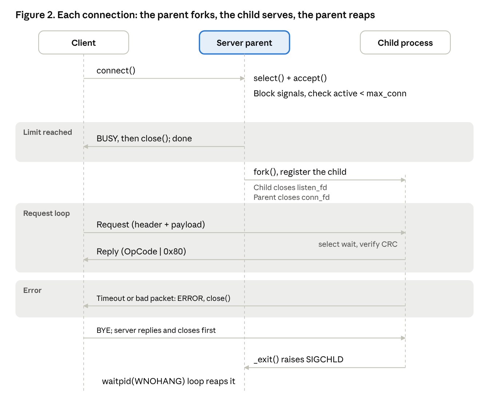
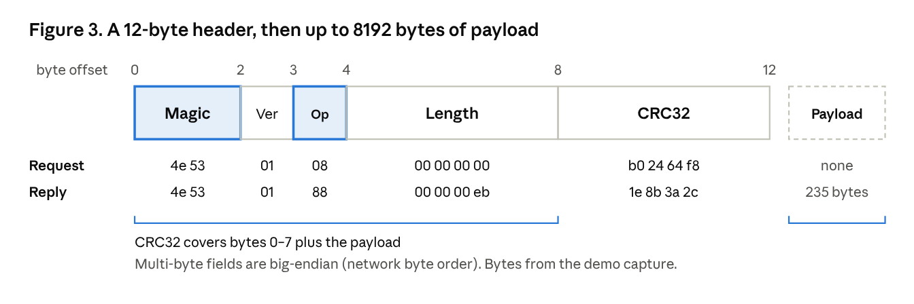
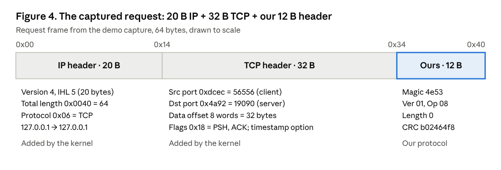

# Fork-Based System Information Client–Server

Network and System Programming — midterm project. A Linux client–server service in C: the server `fork()`s one child process per connection, and clients query the server host's system information over a custom binary protocol with a CRC32 check.

**Quick links:** [Diagrams](#2-diagrams) · [Packet capture and analysis (sniffer)](#4-packet-capture-and-analysis-sniffer) · [Robustness comparisons](#7-robustness-with-and-without-each-mechanism) · [Build and run](#5-build-and-run)

Everything below is reproduced by one command:

```bash
./demo.sh
```

It builds the project, runs 10 concurrent clients, captures the traffic with tcpdump, runs five with/without experiments and checks 34 conditions.

## 1. Requirements

| Requirement | How it is met | Proof |
| --- | --- | --- |
| `fork()` one child per connection, no threads | `accept()` then `fork()`; the child serves that client and exits | 10 clients served by 10 different `worker_pid` (demo stage 5) |
| At least 10 concurrent clients, runtime proof | Limit configurable 1–512, default 32 | `active=10/10`, 10 child processes, `peak=10` (demo stages 4, 8) |
| Packet capture and analysis | tcpdump on loopback | [Section 4](#4-packet-capture-and-analysis-sniffer) |
| Two-level debug log | `#ifdef DEBUG` at compile time, `-d` at run time | demo stages 1, 7, 8 |
| Shared utilities in a `.so`, linked by both sides | `lib/libnetproto.so`, rpath `$ORIGIN/lib` | `readelf` shows `RPATH [$ORIGIN/lib]` (demo stage 2) |
| Client requests system information | Host name, kernel, uptime, load, memory, time | demo stage 5 |
| Robustness, at least three with/without examples | Five comparisons plus malformed-packet tests | [Section 7](#7-robustness-with-and-without-each-mechanism) |
| Makefile or CMake | `make`, `make debug`, `make demo` | demo stages 1, 2 |

## 2. Diagrams

### Process architecture


The parent only accepts connections, enforces the limit, forks and reaps. Each child serves exactly one client, so a slow or crashing client never affects the others. Both programs link the same `libnetproto.so`.

### Connection sequence



Every connection ends in one of three ways: BUSY when the limit is reached, ERROR on timeout or a bad packet, or a normal BYE. In every case the child exits and the parent reaps it. The client waits for the server to close first, so TIME_WAIT always lands on the server's port.

### Packet format



## 3. Protocol

| Offset | Size | Field | Meaning |
| --- | --- | --- | --- |
| 0 | 2 | Magic | `0x4E53` (ASCII "NS") |
| 2 | 1 | Version | 1 |
| 3 | 1 | OpCode | Message type; a reply is `request \| 0x80` |
| 4 | 4 | Length | Payload length, at most 8192 |
| 8 | 4 | CRC32 | IEEE 802.3, over bytes 0–7 and the payload |
| 12 | N | Payload | `key=value` text, ping data or an error message |

All multi-byte fields are big-endian (network byte order) and are serialized field by field with `memcpy`.

| OpCode | Name | Purpose |
| --- | --- | --- |
| 0x01 | PING | Echo the payload |
| 0x02 | HOSTNAME | Host name |
| 0x03 | UPTIME | Seconds since boot |
| 0x04 | LOADAVG | Load average, process count, CPU count |
| 0x05 | MEMINFO | Total and free memory |
| 0x06 | KERNEL | Kernel name, release, architecture |
| 0x07 | TIME | Server local time |
| 0x08 | ALL | All of the above plus the worker PID |
| 0x0F | BYE | End the session |
| 0xFE | BUSY | Connection limit reached; server then closes |
| 0xFF | ERROR | Payload is the error message |

The receiver validates Magic, Version and Length before reading any payload. After a protocol error the stream can no longer be aligned to packet boundaries, so the server replies ERROR and closes; an unknown opcode arrives in a well-formed frame, so the connection stays open.

## 4. Packet capture and analysis (sniffer)

Client and server run on one machine, so traffic crosses the loopback interface. `demo.sh` (stages 3 and 9) captures it with tcpdump, equivalent to:

```bash
sudo tcpdump -i lo -nn -s 0 -U -w demo_out/capture.pcap "tcp port 19090"
```

The resulting `demo_out/capture.pcap` also opens in Wireshark. To keep only packets that carry this protocol, a BPF filter skips the TCP header and tests the first two payload bytes for the magic number:

```bash
tcpdump -nn -r demo_out/capture.pcap 'tcp[((tcp[12] & 0xf0) >> 2):2] = 0x4e53'
```

`tcp[12] & 0xf0` is the TCP data-offset field (header length in 4-byte words, high nibble); `>> 2` converts it to bytes. A demo run matched 50 frames.

One ALL request and its reply from that capture:

```text
IP 127.0.0.1.56556 > 127.0.0.1.19090: Flags [P.], seq 326371271:326371283, ack 2835008425, length 12
0x0000:  4500 0040 1361 4000 4006 2955 7f00 0001
0x0010:  7f00 0001 dcec 4a92 1374 07c7 a8fa cba9
0x0020:  8018 0080 fe34 0000 0101 080a 82cb 2fe8
0x0030:  17c3 a8d5 4e53 0108 0000 0000 b024 64f8

IP 127.0.0.1.19090 > 127.0.0.1.56556: Flags [P.], seq 1:248, ack 12, length 247
0x0030:  82cb 2fe8 4e53 0188 0000 00eb 1e8b 3a2c  ../.NS........:,
0x0040:  686f 7374 6e61 6d65 3d44 4553 4b54 4f50  hostname=DESKTOP
...
```



| Field | Request | Reply | Reading |
| --- | --- | --- | --- |
| Magic | `4e53` | `4e53` | Protocol identifier "NS" |
| Version | `01` | `01` | Version 1 |
| OpCode | `08` | `88` | ALL; reply is `0x08 \| 0x80` |
| Length | `00000000` | `000000eb` | No request payload; 235-byte reply payload |
| CRC32 | `b02464f8` | `1e8b3a2c` | Recomputed from the captured bytes: both match |

Cross-checks:

- IP total length: request `0x0040` = 64 = 20 (IP) + 32 (TCP) + 12; reply `0x012b` = 299 = 20 + 32 + 247, and 247 = 12 + 235.
- The request covers 12 sequence numbers and the reply acknowledges `ack 12`.
- The payload is plaintext, so anyone who can capture the traffic can read it (see [Limitations](#8-limitations)).

## 5. Build and run

```bash
sudo apt-get install -y build-essential tcpdump
git clone https://github.com/bronson0413/network-system-programming-midterm.git
cd network-system-programming-midterm
./demo.sh
```

Only tcpdump needs root; `demo.sh` asks for the sudo password once.

| Make target | Effect |
| --- | --- |
| `make` | Release build, `LOG_DEBUG` not compiled in |
| `make debug` | Debug build with `-DDEBUG` |
| `make clean` | Remove build outputs and `demo_out/` |
| `make demo` | Run `demo.sh` |

Manual run with two terminals:

```bash
# terminal 1
make debug
./server -d -m 12

# terminal 2
./client -q all
./client -q ping
```

| Server option | Meaning | Default |
| --- | --- | --- |
| `-b addr` | Bind address (`0.0.0.0` for other machines) | `127.0.0.1` |
| `-p port` | Listen port | 9000 |
| `-m max_conn` | Connection limit, 1–512 | 32 |
| `-t idle_sec` | Idle timeout in seconds | 30 |
| `-d` | Enable debug log (debug build only) | off |
| `-X name` | Experiments only: disable `reap`, `idle`, `limit`, `reuseaddr` or `crc` | all enabled |

| Client option | Meaning | Default |
| --- | --- | --- |
| `-s host` | Server address | `127.0.0.1` |
| `-p port` | Server port | 9000 |
| `-q query` | `ping`, `hostname`, `uptime`, `load`, `mem`, `kernel`, `time`, `all` | `all` |
| `-w sec` | Keep the connection open after the query | 0 |
| `-t sec` | Reply timeout | 10 |
| `-B` | Send a corrupted ping to test the CRC check | off |
| `-d` | Enable debug log (debug build only) | off |

Client exit codes: 0 success, 1 connection or protocol error, 2 bad arguments, 3 server busy, 4 server reported an error (e.g. idle timeout).

## 6. What `demo.sh` checks

| Stage | What it does | Proves |
| --- | --- | --- |
| 1 | Release build, server started with `-d` | Debug level 1: no DEBUG output, `-d ignored` warning, no debug strings in the `.so` |
| 2 | Debug build, `readelf` and `ldd` | Both programs link `libnetproto.so` through rpath `$ORIGIN/lib` |
| 3 | Start tcpdump on `lo` | Capture for Section 4 |
| 4 | 10 clients, each holds its connection 3 s, limit 10 | 10 live connections, 10 child processes |
| 5 | An 11th client connects | BUSY (exit 3); 10 clients served by 10 different children |
| 6 | Count children after clients exit | 0 zombies, 0 children left |
| 7 | Client idle 7 s, timeout 5 s | Server sends ERROR (exit 4); DEBUG output present with `-d` |
| 8 | Restart on the same port without `-d` | Bind succeeds; no DEBUG output without `-d` (debug level 2) |
| 9 | Stop and read the capture | At least 40 protocol frames; one request/reply printed in hex |
| 10–14 | Five with/without experiments | Section 7 |

## 7. Robustness: with and without each mechanism

The same binary is used in every pair; `-X` disables exactly one mechanism, so any difference comes from that mechanism.

| Mechanism | Disabled with | Experiment | With | Without |
| --- | --- | --- | --- | --- |
| Child reaping (SIGCHLD + `waitpid`) | `-X reap` | 5 clients finish, count zombies | 0 zombies | 5 zombies |
| Idle timeout (`select`) | `-X idle` | Timeout 2 s, client idle 4 s, check at 3 s | 0 children, client exit 4 | 1 child still held, client exit 0 |
| `SO_REUSEADDR` | `-X reuseaddr` | Restart right after the server closed connections (1 TIME_WAIT) | Restart succeeds | `bind: Address already in use` |
| Connection limit | `-X limit` | Limit 5, 8 clients at once | 3 rejected, peak 5 | 0 rejected, peak 8 |
| CRC check | `-X crc` | Client sends a ping with one corrupted byte | Rejected, `CRC mismatch` | Accepted, server replies `Hello from pid ...` |

Malformed input (`tests/malformed_test.py`, server timeout 2 s) sends raw bytes directly:

| Input | Server behaviour |
| --- | --- |
| Wrong Magic / Version | Replies `bad magic` / `unsupported version`, closes |
| Length 4 GiB or 8193 | Replies `bad length` before reading any payload, closes |
| Wrong CRC | Replies `CRC mismatch`, closes |
| Unknown opcode | Replies `unknown opcode`, connection stays open |
| Maximum payload, 8192 bytes | Echoed correctly |
| Half a header or half a payload | Replies `idle timeout` after the 2 s deadline |
| One byte every 0.2 s | Cut off by the whole-packet deadline |
| Many requests, never reading replies | Child ends when sending fails; nothing left behind |
| 500 randomly corrupted packets | Server stays up, no leftover children |

```bash
python3 tests/malformed_test.py ./server
python3 tests/stress_client.py --port 9000 -n 100 -r 20
```

## 8. Limitations

- Traffic is plaintext and there is no authentication; the server binds to `127.0.0.1` by default. Exposing it would need TLS and a token or HMAC.
- CRC32 detects accidental corruption, not deliberate tampering (an attacker can recompute it).
- One source can occupy every slot by sending periodic pings; per-IP limits or a maximum session time would address this.
- The stress client is single-threaded Python, so its throughput (about 12,000 requests/s) is not the server's limit.
- `-X` exists only for the experiments and should not be used in normal operation.

## 9. Project layout

```text
include/netproto.h   protocol constants, opcodes, error codes, log macros, library interface
src/proto.c          CRC32, packet encode/decode, deadline-based socket I/O
src/log.c            log lines with time and PID, one write() per line
src/server.c         process management, signals, connection limit, system information
src/client.c         command-line query tool
Makefile             builds lib/libnetproto.so, server and client
demo.sh              one-command build and verification
tests/               malformed-packet and stress tests (Python)
docs/                diagrams
```
